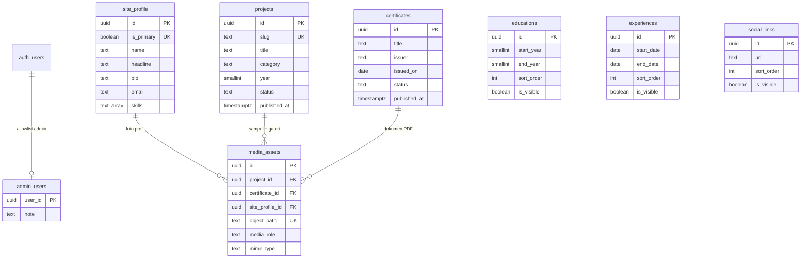

# Tahap 2 — Rancangan Database dan Keamanan Supabase

**Status: RANCANGAN. Belum ada SQL yang dijalankan, belum ada database Supabase yang dibuat atau diubah, dan belum ada kode frontend/UI yang disentuh.**

Dokumen ini menjawab Tahap 2 pada `PRD.md` (bagian 5, 8, 9, 10, 12, 13) dan menutup temuan audit A-03 (area admin tanpa autentikasi) serta B-13 (model data belum punya tanggal terbit, urutan, dan path media).

| Berkas | Isi |
|---|---|
| `supabase/migrations/20261024100000_tahap2_01_schema.sql` | Tabel, foreign key, constraint, indeks, trigger, RLS diaktifkan |
| `supabase/migrations/20261024100100_tahap2_02_access_control.sql` | Schema `private`, `is_admin()`, `is_public_media()`, grants, RLS policy |
| `supabase/migrations/20261024100200_tahap2_03_storage.sql` | Bucket `media` (private) + Storage policy |
| `supabase/tests/00_security_checks.sql` | 36 skenario SQL; uji HTTP H1–H11 dan operasional O1–O4 ada di dokumen 8.3–8.4 (belum dijalankan) |

Yang **tidak** dilakukan pada tahap ini: membuat akun/project Supabase, memasang `@supabase/supabase-js`, mengubah UI, menambah `.env`, atau membuat login palsu.

---

## 0. Ringkasan dalam bahasa sederhana

Ada empat lapisan yang sering tertukar. Anggap website ini sebuah gedung:

1. **Supabase Auth** = resepsionis. Memeriksa email + password dan menerbitkan "kartu identitas" (JWT). Auth hanya menjawab **siapa Anda**, bukan **boleh apa**.
2. **Grants** = daftar izin per pintu. Menentukan role `anon` / `authenticated` boleh `SELECT`, `INSERT`, `UPDATE`, atau `DELETE` pada tabel tertentu — bahkan sebelum melihat isi baris.
3. **RLS (Row Level Security)** = aturan per baris. "Anda boleh masuk ruangan, tapi hanya boleh melihat lemari yang bertanda *published*."
4. **Protected route React** = petunjuk arah di lobi. Bagus untuk pengalaman pengguna (redirect ke login), tetapi **tidak mengunci apa pun**. Siapa pun bisa memanggil API langsung tanpa melewati React.

Keputusan inti rancangan ini:

- Satu tabel `admin_users` berisi `user_id` dari Supabase Auth. Fungsi `private.is_admin()` membaca tabel itu. **Tidak ada nilai dari browser yang menentukan status admin.**
- Pengunjung anonim hanya bisa `SELECT`, dan hanya baris yang memang publik (proyek/sertifikat `published`, entri `is_visible`).
- Bucket Storage **private**. File hanya bisa dibaca publik jika terdaftar di `media_assets` dan konten pemiliknya terbit.
- `service_role`/secret key tidak dipakai di mana pun dalam rancangan ini.

---

## 1. Keputusan desain (ringkas)

| # | Keputusan | Alternatif yang ditolak | Alasan |
|---|---|---|---|
| D-01 | UUID (`gen_random_uuid()`) untuk primary key | integer auto-increment | ID tidak bisa ditebak dan aman dipakai di path file; tidak membocorkan jumlah konten. |
| D-02 | Identitas admin lewat tabel allowlist + `private.is_admin()` | email hardcode di policy, `user_metadata`, role dari browser | Bisa dicabut seketika lewat SQL, tidak butuh secret, tidak bisa diubah user. |
| D-03 | RLS aktif di semua tabel, **plus** grants eksplisit | hanya RLS | RLS tanpa grant yang benar bisa membingungkan; grant tanpa RLS berbahaya. Keduanya diperiksa. |
| D-04 | Bucket `media` private | bucket publik + nama file acak | URL bucket publik berlaku selamanya, termasuk untuk file draft. |
| D-05 | Tabel `media_assets` sebagai registry file | menebak dari prefix folder | Akses file harus mengikuti status konten, bukan mengikuti nama folder atau tombol UI. |
| D-06 | Satu file dimiliki tepat satu konten | file dipakai bersama beberapa konten | Menghapus konten tidak berisiko menghapus file milik konten lain (AC-CONT-03). |
| D-07 | Satu baris `site_profile` lewat `unique(is_primary)` | `id = 1` hardcode, tabel key-value | Tetap memakai UUID, dan database sendiri yang menolak duplikat. |
| D-08 | `published_at` diisi trigger | diisi frontend | Konsisten walau ada jalur update lain; dipakai untuk urutan "terbaru". |
| D-09 | Deskripsi proyek satu kolom `text` | `jsonb` array, tabel paragraf | Cukup untuk MVP; paragraf dipisah baris kosong. |
| D-10 | Pendidikan memakai tahun, pengalaman memakai tanggal | keduanya teks bebas | Urutan dan format bisa dihitung, bukan menebak string. |

---

## 2. Skema database

### 2.1 Istilah yang dipakai

- **Primary key (PK):** kolom identitas unik tiap baris. Di sini selalu `id uuid`.
- **Foreign key (FK):** kolom yang menunjuk baris di tabel lain, misalnya `media_assets.project_id → projects.id`. Database menolak nilai yang tidak ada.
- **Constraint:** aturan yang membuat data buruk gagal disimpan (judul kosong, slug duplikat, status aneh).
- **Index:** "daftar isi" agar pencarian cepat. Terlalu banyak index memperlambat tulis, jadi hanya dibuat untuk pola query yang nyata.
- **`timestamptz`:** waktu + zona waktu. Selalu lebih aman daripada `timestamp` polos.
- **`ON DELETE CASCADE`:** saat induk dihapus, anaknya ikut terhapus (misalnya metadata media milik proyek).

### 2.2 Tabel satu per satu

#### `site_profile` — profil pemilik (1 baris)

| Kolom | Wajib | Tipe | Keterangan |
|---|---|---|---|
| `id` | ya | uuid | PK |
| `is_primary` | ya | boolean | Selalu `true`; diberi `UNIQUE` agar baris kedua ditolak |
| `name`, `headline`, `bio` | ya | text | Panjang dibatasi constraint |
| `initials` | tidak | text | 1–4 karakter, untuk placeholder inisial |
| `location`, `availability` | tidak | text | Ditampilkan bila ada |
| `email` | ya | text | Format dasar divalidasi |
| `skills` | ya | text[] | Default `{}`; urutan mengikuti isi array |
| `created_at`, `updated_at` | ya | timestamptz | `updated_at` diisi trigger |

Foto profil **tidak** disimpan sebagai kolom path di sini, melainkan sebagai baris `media_assets` dengan `media_role = 'profile_photo'`. Dengan begitu hanya ada satu mekanisme akses file.

#### `projects` — karya

| Kolom | Wajib | Keterangan |
|---|---|---|
| `id` | ya | UUID PK |
| `slug` | ya | Unik, format `^[a-z0-9]+(-[a-z0-9]+)*$`, 1–80 karakter |
| `title` | ya | Tidak boleh hanya spasi |
| `category` | ya | Salah satu dari 7 kategori PRD 5.1; nilai harus sama dengan `PROJECT_CATEGORIES` di frontend |
| `year` | tidak | 1950–2100; dipakai untuk tampilan "tahun" |
| `summary` | ya | Ringkasan kartu |
| `description` | ya | Satu teks; paragraf dipisah baris kosong |
| `demo_url`, `repo_url`, `video_url` | tidak | Harus `http(s)://...` bila diisi |
| `status` | ya | `draft` (default) atau `published` |
| `published_at` | tidak | Diisi trigger saat pertama kali terbit |
| `created_at`, `updated_at` | ya | Otomatis |

#### `certificates`

| Kolom | Wajib | Keterangan |
|---|---|---|
| `title`, `issuer` | ya | Teks |
| `issued_on` | tidak | `date`; boleh kosong karena PRD menyebut "bila diketahui" |
| `credential_url` | tidak | URL kredensial eksternal |
| `status` | ya | `draft` / `published` |
| `published_at` | tidak | Trigger, sama seperti proyek |

Dokumen PDF disimpan di `media_assets` (`media_role = 'certificate_document'`, hanya `application/pdf`). Ini menutup temuan audit B-12: path/berkas benar-benar ada dan bisa dirender sebagai tautan.

#### `educations`

`institution`, `program` (wajib), `start_year` (wajib), `end_year` (opsional; `NULL` = "Sekarang"), `summary` (opsional), `sort_order` (default 0), `is_visible` (default true).

#### `experiences`

`organization`, `role` (wajib), `start_date` (wajib), `end_date` (opsional; `NULL` = "Sekarang"), `summary` (opsional), `sort_order`, `is_visible`.

#### `social_links`

`platform`, `url` (wajib, http/https), `label` (opsional; UI memakai `platform` bila kosong), `sort_order`, `is_visible`.

#### `media_assets` — registry file

| Kolom | Wajib | Keterangan |
|---|---|---|
| `project_id` / `certificate_id` / `site_profile_id` | tepat satu | Dijaga `check (num_nonnulls(...) = 1)` |
| `bucket_id` | ya | Default `media` |
| `object_path` | ya | Path di bucket, tanpa garis miring awal; unik per bucket |
| `media_role` | ya | `profile_photo`, `cover`, `gallery`, `certificate_document` |
| `mime_type` | ya | JPEG/PNG/WebP/PDF, dan harus cocok dengan role |
| `size_bytes` | tidak | Untuk audit kuota |
| `alt_text` | tidak | Untuk aksesibilitas |
| `sort_order` | ya | Urutan galeri |

Constraint tambahan:

- satu `cover` per proyek, satu `profile_photo` per profil, satu dokumen per sertifikat (partial unique index);
- `project_id` hanya untuk `cover`/`gallery`, `certificate_id` hanya untuk `certificate_document` (tidak bisa salah pasang);
- `object_path` tidak boleh diawali `/`.

#### `admin_users` — allowlist admin

`user_id uuid primary key references auth.users(id) on delete cascade`, `note`, `created_at`.

Tidak ada policy tulis. Menambah/mencabut admin dilakukan lewat SQL Editor oleh pemilik project, bukan lewat aplikasi. Jika akun Auth dihapus, barisnya ikut hilang.

### 2.3 Yang sengaja **tidak** dibuat

- **Tabel `skills`:** PRD tidak memintanya; array pada profil cukup dan menghindari CRUD tambahan.
- **Tabel galeri terpisah:** galeri sudah diwakili `media_assets` dengan `media_role = 'gallery'`.
- **Tabel kategori:** nilai kategori dikontrol lewat `check` constraint (7 nilai tetap), bukan tabel baru. Lebih sedikit join dan tidak bisa diisi variasi ejaan.
- **Tabel pengaturan situs:** tidak ada kebutuhan di MVP.
- **Tabel log aktivitas / multi-admin:** di luar cakupan (F-25 P2).

### 2.4 Aturan lintas tabel

- **Satu profil:** `unique(is_primary)` + `check (is_primary)` = maksimal satu baris. Tidak ada policy INSERT/DELETE untuk API, jadi profil tidak bisa digandakan dari aplikasi.
- **Satu file satu pemilik:** tidak ada file bersama, sehingga penghapusan aman.
- **Timestamp:** semua tabel punya `created_at`; semua kecuali `admin_users` punya `updated_at` yang diisi trigger.
- **Publikasi:** `status` hanya untuk proyek dan sertifikat (sesuai asumsi A-03). Data profil/pendidikan/pengalaman/sosial memakai `is_visible` atau langsung tampil setelah disimpan.

---

## 3. Diagram hubungan tabel



Versi teks (untuk yang tidak bisa merender Mermaid):

```text
auth.users ──1:0..1── admin_users
site_profile ──1:0..n── media_assets ──n:1── projects
                                     └──n:1── certificates

projects      : id, slug (unik), status, published_at
certificates  : id, status, published_at
media_assets  : tepat satu dari project_id / certificate_id / site_profile_id
```

---

## 4. Autentikasi dan otorisasi

### 4.1 Tiga hal yang berbeda

| Lapisan | Menjawab | Bisa diakali dari browser? | Perannya di proyek ini |
|---|---|---|---|
| **Supabase Auth** | "Siapa Anda?" (email + password → JWT) | Tidak, selama password tidak bocor | Login/logout satu admin. Sign-up publik dimatikan. |
| **Database (grants + RLS)** | "Boleh baca/tulis apa?" | Tidak, dievaluasi di server database | Pertahanan utama. Semua policy di bagian 5. |
| **Protected route React** | "Halaman mana yang perlu diarahkan ke login?" | Ya — tinggal matikan JS atau panggil API langsung | Hanya kenyamanan UI (F-20). Bukan pengamanan. |

Konsekuensi praktis: jika RLS salah, menyembunyikan tombol atau memasang `<ProtectedRoute>` tidak menyelamatkan data. Sebaliknya, jika RLS benar, route guard yang lupa dipasang hanya menyebabkan tampilan kosong/error, bukan kebocoran.

### 4.2 Perbandingan cara memverifikasi admin

| Pendekatan | Keamanan | Kemudahan | Konsekuensi |
|---|---|---|---|
| **A. Email hardcode di policy** (`auth.jwt()->>'email' = '...'`) | Sedang | Mudah di awal | Rusak saat email berubah; email di JWT bisa berubah; sulit menambah admin kedua; tidak ada jejak. |
| **B. Custom claim di `app_metadata`** (`auth.jwt()->'app_metadata'->>'role' = 'admin'`) | Tinggi (hanya `service_role`/Admin API yang bisa mengubah) | Sedang | Butuh secret/Admin API untuk mengubah role; JWT lama tetap membawa claim lama sampai refresh; pencabutan tidak instan. |
| **C. Tabel allowlist + fungsi `is_admin()`** ✅ | Tinggi | Mudah | Perlu satu langkah SQL saat menambah admin; perubahan berlaku pada request berikutnya. |
| **D. Login database terpisah** (user Postgres khusus) | Tinggi | Sulit | Tidak terhubung ke Supabase Auth; harus menyimpan kredensial tambahan; bertentangan dengan PRD 10.1. |

### 4.3 Rekomendasi: C — allowlist di database

```sql
create table public.admin_users (
  user_id uuid primary key references auth.users (id) on delete cascade,
  ...
);

create function private.is_admin() returns boolean
language sql stable security definer set search_path = ''
as $$
  select exists (
    select 1 from public.admin_users a
    where a.user_id = (select auth.uid())
  );
$$;
```

Mengapa aman:

- `auth.uid()` berasal dari JWT yang ditandatangani Supabase, bukan dari form/`localStorage`.
- Daftar admin tidak punya policy tulis, jadi tidak bisa diubah lewat API meski akunnya admin.
- Mencabut admin = `delete from public.admin_users where user_id = '...'`, langsung berlaku.
- `security definer` + `set search_path = ''` mencegah fungsi "dibajak" lewat schema lain.

**Jangan gunakan `raw_user_meta_data` / `user_metadata`** untuk status admin: kolom itu bisa diubah sendiri oleh user lewat `supabase.auth.updateUser({ data: ... })`. `app_metadata` aman dari user, tetapi pendekatan C lebih mudah dipelihara dan langsung berlaku.

### 4.4 Alur login dan penyiapan admin (Tahap 4)

1. Di Dashboard Supabase: **Authentication → Sign In / Providers → matikan "Allow new users to sign up"**. Tidak ada pendaftaran publik.
2. Buat satu user admin lewat **Authentication → Users → Add user** (email + password). Konfirmasi email bila diminta.
3. Jalankan sekali di SQL Editor:
   ```sql
   insert into public.admin_users (user_id, note)
   select id, 'admin utama' from auth.users where email = 'email-anda@contoh.com';
   ```
4. Frontend login memakai `supabase.auth.signInWithPassword`. Setelah sesi ada, frontend boleh menanyakan `select * from public.admin_users` (policy hanya mengembalikan baris miliknya) untuk memutuskan apakah menu admin ditampilkan.
5. Route guard hanya mengalihkan ke `/admin/login`; semua operasi tetap divalidasi database. Jika user login tetapi bukan admin, seluruh tabel konten mengembalikan 0 baris dan semua tulis ditolak RLS.

Catatan keamanan: pesan error login harus umum ("Email atau password salah"), jangan membedakan "email tidak terdaftar". Ini sudah menjadi catatan di PRD 7.3 dan akan dikerjakan di Tahap 4.

---

## 5. RLS dan grants

### 5.1 Matriks akses database

`S` = SELECT, `I` = INSERT, `U` = UPDATE, `D` = DELETE. `—` = ditolak.

| Tabel | anon (pengunjung) | authenticated non-admin | admin (`admin_users`) |
|---|---|---|---|
| `site_profile` | S (1 baris) | S (1 baris) | S, U |
| `projects` | S hanya `status = 'published'` | S hanya `status = 'published'` | S, I, U, D semua baris |
| `certificates` | S hanya `published` | S hanya `published` | S, I, U, D semua baris |
| `educations` | S hanya `is_visible` | S hanya `is_visible` | S, I, U, D semua baris |
| `experiences` | S hanya `is_visible` | S hanya `is_visible` | S, I, U, D semua baris |
| `social_links` | S hanya `is_visible` | S hanya `is_visible` | S, I, U, D semua baris |
| `media_assets` | S hanya baris milik konten terbit / foto profil | sama seperti anon | S, I, U, D semua baris |
| `admin_users` | — (tidak ada grant) | S hanya baris sendiri | S hanya baris sendiri (tulis via SQL Editor) |
| `storage.objects` (bucket `media`) | S hanya file konten terbit / foto profil; tanpa I/U/D | sama seperti anon | S, I, U, D semua file di bucket `media` |

Yang perlu dipahami dari matriks ini:

- **Login tidak sama dengan admin.** Baris "authenticated non-admin" sengaja identik dengan anon. Ini yang diuji T13–T17.
- **Admin_users tidak bisa ditulis lewat API sama sekali**, termasuk oleh admin. Ini disengaja: perubahan admin harus lewat SQL/dashboard agar tidak bisa dieksploitasi dari sesi yang dicuri.
- **`site_profile` tidak punya I/D** untuk siapa pun lewat API. Baris tunggalnya dibuat saat penyiapan; admin hanya memperbarui.

### 5.2 Penjelasan policy

**Baca publik** (berlaku `to anon, authenticated`):

- `projects_public_read`: `using (status = 'published')` — draft tidak pernah keluar dari database untuk pengunjung, bahkan jika URL detail diketik manual.
- `certificates_public_read`: sama untuk sertifikat.
- `educations_public_read`, `experiences_public_read`, `social_links_public_read`: `using (is_visible)`.
- `media_assets_public_read`: baris terlihat hanya jika `media_role = 'profile_photo'`, atau proyek pemiliknya `published`, atau sertifikat pemiliknya `published`. Ini mencegah path file draft diketahui dari API tabel.
- `site_profile_public_read`: `using (true)` karena profil memang publik dan hanya satu baris.

**Tulis admin** (`to authenticated`, memakai `private.is_admin()`):

- `*_admin_all` memakai `for all using (...) with check (...)`. `using` mengatur baris yang boleh dibaca/diubah/dihapus; `with check` mengatur baris hasil INSERT/UPDATE. Keduanya wajib ada, kalau hanya `using`, INSERT tetap bisa lolos dengan nilai aneh.
- `(select private.is_admin())` dibungkus subquery agar Postgres menghitungnya sekali per query (InitPlan), bukan sekali per baris.
- `site_profile_admin_update` hanya `update`; tidak ada policy insert/delete.
- `admin_users_read_self`: `user_id = (select auth.uid())` — cukup untuk UI mengetahui "saya admin", tanpa membocorkan daftar admin.

### 5.3 Grants — lapisan yang sering terlupa

RLS tidak berguna jika role tidak punya grant yang tepat, dan grant yang terlalu longgar tetap berbahaya walau RLS ketat. Karena itu setiap tabel di-`revoke all` lebih dulu, lalu diberi grant minimum:

```sql
-- contoh: projects
revoke all on table public.projects from anon, authenticated;
grant select on table public.projects to anon;
grant select, insert, update, delete on table public.projects to authenticated;
```

Hal yang diperiksa:

- **`anon` tidak punya INSERT/UPDATE/DELETE** di tabel mana pun.
- **`anon` tidak punya grant apa pun pada `admin_users`** (bahkan SELECT).
- **Fungsi bantu:** Postgres memberi `EXECUTE` ke `PUBLIC` secara default, jadi `revoke all ... from public` wajib, lalu `grant execute` hanya ke role yang perlu. `anon` boleh memanggil `private.is_public_media()` (dipakai policy Storage) tetapi **tidak** boleh memanggil `private.is_admin()`.
- **Schema `private`:** `revoke all on schema private from public; grant usage ... to anon, authenticated;` — tanpa USAGE, policy Storage tidak bisa memanggil fungsi; dengan USAGE saja, tabel tetap tidak terbuka. Schema ini **tidak boleh** dimasukkan ke daftar schema yang diekspos Data API; cara memeriksanya ada di 8.4 (O1–O3).
- **Default privileges:** Supabase sedang mengubah perilaku grant otomatis untuk tabel baru. Migration ini selalu memberi grant eksplisit, sehingga hasilnya sama di project lama maupun baru.
- **`service_role`:** tidak pernah dipakai di frontend maupun migration. Kunci ini melewati RLS sepenuhnya; kalau bocor, seluruh aturan di atas tidak berlaku.

### 5.4 Jebakan yang harus dihindari saat Tahap 3–5

1. **SQL Editor berjalan sebagai `postgres`.** Pemilik tabel melewati RLS, jadi `select * from projects` di sana memperlihatkan draft. Itu bukan bukti RLS rusak. Uji dengan `set role anon;`.
2. **Jangan menonaktifkan RLS** untuk "memperbaiki" error `permission denied`. Error itu justru tanda aturan bekerja; perbaiki grant/policy-nya.
3. **Jangan menambah policy `using (true)` untuk tulis.** Untuk baca profil boleh; untuk tulis adalah pintu terbuka.
4. **Jangan memakai `user_metadata`** sebagai penentu admin (bisa diubah user).
5. **Jangan memakai kolom sensitif baru tanpa meninjau grant.** Saat ini anon mendapat SELECT seluruh kolom. Jika nanti ada kolom internal (misalnya catatan pribadi), perlu view/column grant — dan `select=*` di PostgREST bisa gagal bila grant per kolom tidak lengkap.
6. **Jangan lupa `with check`** pada policy INSERT/UPDATE.

---

## 6. Storage (gambar dan PDF)

### 6.1 Opsi arsitektur

| Opsi | Manfaat | Kompleksitas | Konsekuensi |
|---|---|---|---|
| **A. Bucket publik + nama file acak** | Paling sederhana, URL bisa di-cache CDN | Rendah | Siapa pun yang pernah melihat URL file draft bisa membukanya selamanya. Tidak memenuhi AC-SEC-02. **Ditolak.** |
| **B. Bucket private + registry `media_assets`** ✅ | Akses mengikuti status konten; bisa dicabut; satu tempat audit | Sedang | Perlu signed URL berumur pendek; satu tabel tambahan. |
| **C. Bucket private + pola path (`projects/<id>/...`)** | Tanpa tabel registry | Sedang | Policy harus mem-parse path dan join ke proyek; rename/pindah file rawan; tidak ada tempat menyimpan alt text/urutan/mime. |
| **D. Edge Function yang menyalurkan file** | Kontrol penuh per request, bisa mencatat akses | Tinggi | Perlu function + secret server; menambah titik gagal dan biaya invocation. Berlebihan untuk MVP. |

### 6.2 Pilihan: B (private + registry)

Bucket `media`:

- `public = false` → setiap baca harus lolos policy.
- `file_size_limit = 10 MB` (batas tertinggi; PDF 10 MB sesuai PRD).
- `allowed_mime_types = image/jpeg, image/png, image/webp, application/pdf`.

Policy:

```sql
-- baca: hanya file yang terhubung ke konten terbit
create policy media_read_published_files on storage.objects
  for select to anon, authenticated
  using (bucket_id = 'media' and (select private.is_public_media(bucket_id, name)));

-- kelola: hanya admin
create policy media_admin_manage_files on storage.objects
  for all to authenticated
  using (bucket_id = 'media' and (select private.is_admin()))
  with check (bucket_id = 'media' and (select private.is_admin()));
```

`is_public_media()` mencari baris `media_assets` dengan `object_path` yang sama dan memeriksa status pemiliknya. Jadi aturan berlaku **sampai ke path file**, bukan sekadar menyembunyikan tombol.

### 6.3 Konvensi path

```text
projects/<project_id>/cover-<uuid>.webp
projects/<project_id>/gallery-<uuid>.webp
certificates/<certificate_id>/doc-<uuid>.pdf
profile/<uuid>.webp
```

- Nama asli file **tidak** dipakai sebagai identitas; UUID mencegah benturan nama.
- Path disimpan di `media_assets.object_path`, bukan di kolom tabel konten.
- Konvensi folder berguna untuk manusia; **keputusan akses tetap dari registry**, bukan dari prefix path.

### 6.4 Bagaimana pengunjung membaca file

Karena bucket private, `getPublicUrl()` tidak berguna. Alurnya:

1. Halaman publik mengambil metadata (`media_assets`) yang boleh dilihat.
2. Frontend meminta signed URL berumur pendek:
   ```ts
   const { data } = await supabase.storage
     .from('media')
     .createSignedUrl(asset.object_path, 60) // 60 detik
   ```
3. `createSignedUrl` hanya berhasil jika policy SELECT mengizinkan path itu. File draft → error, bukan URL.
4. URL hasilnya dipakai di `` / tautan unduh.

**Batas penting:** signed URL adalah token bertanda tangan. Setelah dibuat, URL itu tetap bisa dibuka sampai kedaluwarsa, walaupun kontennya ditarik ke draft. Karena itu:

- gunakan masa berlaku pendek (60 detik) dan minta URL baru setiap kali halaman dimuat;
- jangan menyimpan signed URL di database atau `localStorage`;
- dokumentasikan bahwa pencabutan akses file berlaku setelah maksimal 60 detik.

Jika kelak butuh pencabutan instan, opsi D (Edge Function) adalah jalan yang benar — bukan mengubah bucket menjadi publik.

### 6.5 Transisi draft ↔ published

| Aksi | Data (RLS) | File baru (signed URL) | File yang sudah beredar |
|---|---|---|---|
| draft → published | Baris langsung terlihat publik | `is_public_media` menjadi true, signed URL bisa dibuat | — |
| published → draft | Baris langsung hilang dari publik | Policy menolak, signed URL baru gagal | URL lama tetap valid sampai kedaluwarsa (≤ 60 detik) |
| hapus konten | Baris + metadata media terhapus (cascade) | — | File harus dihapus lewat Storage API sebelum/ sesudahnya; lihat 6.6 |

Status tidak mengubah data. Menarik publikasi bukan menghapus (AC-PUB-STATUS-01).

Dua hal ini sering tertukar dan harus diuji terpisah:

- **Permintaan signed URL baru** setelah status menjadi draft: ditolak saat itu juga, karena policy SELECT tidak lagi mengizinkan path tersebut.
- **Signed URL yang sudah diterbitkan** sebelum status berubah: tetap bisa dibuka sampai `exp` (≤ 60 detik). Ini batas token, bukan policy yang gagal.

Karena itu H9 (URL lama) dan H10 (permintaan baru) di bagian 8.3 tidak boleh digabung.

### 6.6 Hapus konten, file yatim, dan kegagalan sebagian

Urutan yang disarankan saat admin menghapus proyek:

1. Kumpulkan `media_assets` proyek tersebut.
2. Panggil `storage.from('media').remove(paths)`.
3. Hapus baris `projects` (metadata media ikut terhapus lewat cascade).

Karena `database` tidak bisa memanggil Storage API, langkah ini harus ada di aplikasi. Jika langkah 2 gagal, **jangan** melaporkan sukses: tampilkan peringatan dan sediakan pemeriksaan berkala:

```sql
-- file di Storage yang tidak punya baris media_assets (kandidat yatim)
select o.name
from storage.objects o
left join public.media_assets ma
  on ma.bucket_id = o.bucket_id and ma.object_path = o.name
where o.bucket_id = 'media' and ma.id is null;

-- metadata yang file-nya sudah tidak ada
select ma.bucket_id, ma.object_path
from public.media_assets ma
left join storage.objects o
  on o.bucket_id = ma.bucket_id and o.name = ma.object_path
where o.id is null;
```

Karena satu file hanya dimiliki satu konten (D-06), tidak ada risiko menghapus file milik konten lain.

### 6.7 Batasan yang perlu diketahui

- Batas ukuran bucket berlaku sama untuk semua file (10 MB). Batas gambar 5 MB **tidak bisa** ditegakkan per tipe di level bucket; harus divalidasi di aplikasi (dan dicatat di `size_bytes`). Ini jujur dicatat sebagai batasan, bukan diklaim aman sepenuhnya.
- `allowed_mime_types` memeriksa MIME yang dikirim, bukan isi file. Untuk MVP ini cukup; validasi sihir byte bisa ditambahkan nanti.
- Policy SELECT yang sama juga mengizinkan `list()` folder. Anon hanya bisa melihat daftar file **terbit**; file draft tidak muncul. Jika ingin memblokir listing sepenuhnya, Supabase menyediakan helper operation-aware (`storage.allow_any_operation`) — belum dipakai agar policy tetap sederhana dan mudah dibaca.

---

## 7. Migration

### 7.1 Urutan dan isi

| File | Isi | Efek setelah diterapkan |
|---|---|---|
| `20261024100000_tahap2_01_schema.sql` | 8 tabel, constraint, index, trigger, RLS aktif, semua grant dicabut | Tabel ada, tetapi **tidak ada akses API sama sekali** |
| `20261024100100_tahap2_02_access_control.sql` | schema `private`, 2 fungsi, grants, 15 policy | Baca publik + tulis admin berfungsi |
| `20261024100200_tahap2_03_storage.sql` | bucket `media`, 2 policy Storage | File terbit bisa dibaca, file draft tertutup |
| `supabase/tests/00_security_checks.sql` | 36 skenario SQL + fixture database + rollback; 5 file Storage diunggah manual | Hanya dijalankan manual; tidak mengubah data permanen; file uji dibersihkan lewat Storage API. Uji HTTP/operasional terpisah di 8.3–8.4 |

Urutan ini disengaja: tabel dibuat dengan RLS aktif dan tanpa grant, jadi tidak ada jendela waktu di mana tabel baru terbuka.

### 7.2 Cara menerapkan (nanti, setelah Anda setuju)

Pilih salah satu, **pada project uji** lebih dulu:

- **Lewat Dashboard:** buka SQL Editor, tempel isi file 01, jalankan; ulangi untuk 02 dan 03. Catat bahwa file 02 bergantung pada 01.
- **Lewat Supabase CLI (disarankan):** simpan folder `supabase/` di repo, lalu `supabase link` dan `supabase db push`. Migration tercatat dan bisa diulang di project lain.

Aturan pemeliharaan:

- Migration yang sudah diterapkan **jangan diedit**; buat file baru dengan timestamp lebih besar.
- Jangan menjalankan migration pada project produksi tanpa mencoba di project uji.
- Sebelum menerapkan, buat backup/catat kondisi awal (PRD 10.6).

### 7.3 Catatan penting sebelum menerapkan migration Storage

`storage.objects` adalah tabel bersama milik Supabase Storage, bukan tabel baru milik aplikasi ini. Policy permissive (default) digabungkan dengan **OR**: policy lama yang mengizinkan `anon` membaca lebih luas tetap berlaku, walaupun policy baru kita ketat. Hanya policy `restrictive` yang digabungkan dengan AND. Migration 03 **hanya menambah** dua policy dan menyetel bucket menjadi private; migration itu tidak menghapus policy lama.

Terapkan migration 03 pada salah satu kondisi berikut.

**Opsi 1 — project uji yang bersih.** Belum pernah ada eksperimen Storage atau policy manual. Ini pilihan yang disarankan.

**Opsi 2 — project yang sudah punya policy pada `storage.objects`.** Audit dulu dengan query baca-saja berikut, sebelum migration dijalankan:

```sql
select policyname, permissive, roles, cmd, qual, with_check
from pg_policies
where schemaname = 'storage' and tablename = 'objects'
order by policyname;
```

Periksa setiap baris. Policy yang membuka `public`/`anon` untuk SELECT pada seluruh bucket (misalnya `using (true)`) akan memperluas akses meskipun policy migration kita ketat. Jangan menghapus policy yang belum dipahami: catat temuan, minta persetujuan, lalu hapus eksplisit dengan nama policy-nya. Jangan menonaktifkan RLS, dan jangan mengganti nama policy migration agar “bentrok” hilang — biarkan migration gagal dengan jelas.

Setelah migration: pastikan bucket `media` benar-benar `public = false`, lalu jalankan H7–H11. H8 dan H10 (file draft) adalah pemeriksaan terpenting: jika file draft masih bisa menghasilkan signed URL, kemungkinan besar ada policy lama yang permisif.

### 7.4 Yang belum ada di folder ini

- `supabase/config.toml` dan `.env.example` — belum dibuat karena belum ada project/kredensial. Akan diperlukan di Tahap 3.
- Seed data produksi (profil asli, proyek asli) — sengaja tidak dibuat; isi lewat admin setelah login bekerja.

---

## 8. Rencana pengujian keamanan

### 8.1 Status dan prasyarat

Tidak ada satu pun skenario di bawah yang sudah dijalankan. Alasannya: batasan tahap ini melarang menyentuh Supabase, dan tidak ada PostgreSQL lokal dengan schema `auth`/`storage` untuk menirunya. SQL di `supabase/tests/00_security_checks.sql` adalah rancangan yang harus dijalankan setelah migration diterapkan.

Prasyarat sebelum menjalankan skrip:

1. **Database:** migration 01–03 diterapkan pada project uji. Fixture database dibuat di dalam satu transaksi dan selalu diakhiri `ROLLBACK`.
2. **Akun admin:** ganti `test.admin_email` di baris awal skrip dengan email user yang sudah dibuat di Authentication > Users. Skrip mengambil `user_id` dari `auth.users`, berhenti dengan pesan jelas jika akun tidak ditemukan, dan hanya menambahkan user ke `admin_users` bila belum terdaftar. Baris/catatan admin yang sudah ada tidak diubah.
3. **File Storage:** unggah lima file berikut ke bucket `media` sebagai admin, lewat Dashboard atau Storage API. Isi file boleh gambar/PDF kecil yang valid; yang diuji adalah path dan status kontennya.

   | Path | MIME |
   |---|---|
   | `projects/uji-terbit/cover.webp` | `image/webp` |
   | `projects/uji-draft/galeri.webp` | `image/webp` |
   | `certificates/uji-terbit/dokumen.pdf` | `application/pdf` |
   | `certificates/uji-draft/dokumen.pdf` | `application/pdf` |
   | `profile/foto-uji.webp` | `image/webp` |

4. **Pembersihan:** hapus kelima file lewat Dashboard atau Storage API (`storage.from('media').remove([...])`). Jangan menghapus baris `storage.objects` dengan SQL.

Skrip **tidak memakai** `INSERT` ke `storage.objects` untuk membuat atau mengubah fixture. Satu-satunya percobaan INSERT adalah probe T11 (anon) yang justru harus ditolak; jika tidak ditolak, skrip berhenti dan transaksi di-rollback. Tabel itu hanya metadata internal: menambah baris tidak membuat file dan tidak membuktikan isi bucket. Karena itu T6/T28/T30/T35/T36 hanya memeriksa metadata dan policy, sedangkan akses file nyata (signed URL, unduh, upload, masa berlaku setelah transisi status) diuji lewat HTTP pada 8.3.

Jika project uji tidak bersih, audit policy `storage.objects` lebih dulu sesuai 7.3.

**Cara membaca hasil — penting.** Skrip yang selesai tanpa SQL error hanya berarti seluruh statement berhasil dijalankan; itu **bukan** bukti semua tes lulus.

- Pemeriksaan dengan kolom `lulus`: hanya `true` yang lulus. `false` adalah kegagalan yang **tidak menghentikan skrip** dan harus dibaca satu per satu.
- Pemeriksaan berbentuk `DO`: `NOTICE ... LULUS` berarti lulus; `raise exception ... GAGAL` menghentikan skrip (kegagalan keras).
- Jika skrip berhenti di tengah, transaksi dibatalkan dan tidak ada hasil yang tersisa; perbaiki penyebabnya lalu ulangi dari awal.
- Jangan memakai exit code atau pesan “Success” sebagai kriteria rilis.

Untuk membuat kegagalan lebih mudah terdeteksi, ada dua pendekatan yang disarankan (belum diterapkan di skrip):

1. **Tabel hasil + assertion akhir.** Setiap SELECT menulis ke tabel sementara, lalu satu blok di akhir menggagalkan transaksi jika ada yang false:

   ```sql
   create temp table test_results (
     id text primary key,
     description text not null,
     passed boolean not null
   );

   insert into test_results (id, description, passed)
   select 'T1', 'anon hanya melihat proyek terbit', count(*) = 1
   from public.projects where slug like 'uji-%';

   -- di akhir, sebelum ROLLBACK:
   do $$
   declare failed text;
   begin
     select string_agg(id, ', ' order by id) into failed
     from test_results where passed is not true;

     if failed is not null then
       raise exception 'Tes gagal: %', failed;
     end if;
   end;
   $$;
   ```

2. **pgTAP.** Ubah setiap cek menjadi `ok(kondisi, 'T1 ...')` dengan `plan(36)` di awal. pgTAP menghasilkan status lulus/gagal per assertion dan exit code non-zero, sehingga cocok untuk CI.

Keduanya tidak menghapus skenario yang ada; hanya mengubah cara hasil dilaporkan.

### 8.2 Skenario

| ID | Skenario | Harapan | Lapisan yang diuji |
|---|---|---|---|
| T1 | anon SELECT proyek | Hanya 1 proyek uji `published` | RLS + grant |
| T2 | anon SELECT proyek draft | 0 baris | RLS |
| T3 | anon SELECT sertifikat | 1 terbit, 0 draft | RLS |
| T4 | anon SELECT pendidikan/pengalaman/sosial | Hanya yang `is_visible` | RLS |
| T5 | anon SELECT `media_assets` | 3 baris publik, 2 baris draft tidak terlihat | RLS |
| T6 | anon SELECT metadata `storage.objects` untuk 5 file uji yang sudah diunggah | 3 file terbit terlihat, 2 file draft tidak terlihat | Storage policy (metadata) |
| T7 | anon panggil `is_public_media` | true untuk file terbit, false untuk draft | Fungsi definer |
| T8–T10 | anon INSERT/UPDATE/DELETE proyek | Ditolak | Grant |
| T11 | anon INSERT objek Storage (probe yang diharapkan gagal, bukan fixture) | Ditolak | Storage policy |
| T12 | anon SELECT `admin_users` | Ditolak | Grant |
| T13 | non-admin SELECT proyek | Sama seperti anon (1 baris) | RLS |
| T14 | non-admin SELECT `admin_users` | 0 baris | RLS |
| T15–T17 | non-admin INSERT/UPDATE/DELETE | Ditolak (login ≠ admin) | RLS + policy |
| T18 | admin SELECT proyek | 2 baris (draft + terbit) | RLS |
| T19 | admin SELECT `admin_users` | 1 baris (miliknya) | RLS |
| T20–T21 | admin INSERT/UPDATE | Berhasil, `published_at` terisi | Policy + trigger |
| T22 | slug duplikat | Ditolak `unique_violation` | Constraint |
| T23–T25 | judul kosong / kategori salah / slug salah | Ditolak `check_violation` | Constraint |
| T26 | admin DELETE | Berhasil | Policy |
| T27–T31 | tarik terbit → metadata file tertutup; terbitkan → terbuka; `published_at` | Sesuai tabel 6.5 (metadata; akses file nyata diuji H7–H11) | RLS + Storage policy (metadata) |
| T32–T33 | audit grant | anon hanya SELECT; non-admin punya grant tapi dibatasi RLS | Grant |
| T34 | RLS aktif di 8 tabel | Semua `relrowsecurity = true` | Konfigurasi |
| T35 | Setiap baris `media_assets` uji punya objek di bucket (`bucket_id` + `object_path`) | Tidak ada metadata tanpa file | Konsistensi data |
| T36 | Setiap objek uji di bucket punya baris `media_assets` | Tidak ada file yatim | Konsistensi data |

Catatan perilaku PostgreSQL: INSERT yang ditolak RLS menghasilkan error `42501`, tetapi **UPDATE/DELETE yang ditolak RLS biasanya tidak error** — PostgreSQL hanya menyaring baris sehingga 0 baris terpengaruh. Saat menguji manual, periksa jumlah baris yang berubah, jangan hanya menunggu pesan error. Skrip T16/T17 sudah memakai pola ini.

### 8.3 Uji lewat HTTP (melengkapi SQL)

Uji SQL di 8.2 tidak mengunggah, mengunduh, atau membuat signed URL. Karena itu hasil T6/T28/T30/T35/T36 adalah bukti tentang **metadata dan policy**, bukan bukti bahwa file benar-benar dapat diakses atau tertutup.

Prasyarat:

- Migration 01–03 sudah diterapkan dan bucket `media` berisi file uji (lihat 8.1).
- **Gunakan data uji persisten.** Fixture skrip SQL selalu di-`ROLLBACK`, jadi tidak bisa dipakai untuk uji HTTP. Buat proyek terbit + sampul, proyek draft + file, serta satu user non-admin khusus, lalu hapus setelah selesai.
- Gunakan **publishable/anon key** untuk request anonim — jangan pernah `service_role`. Untuk sesi admin/non-admin, login lewat Supabase Auth dan pakai access token sesi tersebut.
- Uji ini bisa dijalankan segera setelah migration + data uji tersedia; tidak perlu menunggu Tahap 3.

| ID | Request | Harapan |
|---|---|---|
| H1 | `GET /rest/v1/projects?select=*` dengan anon key | Hanya proyek `published` |
| H2 | `GET /rest/v1/projects?slug=eq.<draft>` | `[]` |
| H3 | `POST /rest/v1/projects` dengan anon key | `401/403` |
| H4 | `PATCH`/`DELETE` dengan anon key | `401/403` |
| H5 | Login admin → `POST /rest/v1/projects` | Berhasil |
| H6 | Login non-admin → `POST /rest/v1/projects` | Ditolak RLS (`42501`) |
| H7 | `POST /storage/v1/object/sign/media/<file-terbit>` dengan anon key | `200` + `signedURL` |
| H8 | Minta signed URL untuk file milik konten yang **belum pernah** terbit | Ditolak (4xx, tanpa `signedURL`) |
| H9 | **URL lama:** buat signed URL H7 selagi terbit, tarik publikasi proyek, lalu buka URL **yang sama** sebelum 60 detik habis | Masih `200` — token lama berlaku sampai `exp`; ini batas yang diterima, bukan policy gagal |
| H10 | **URL baru:** setelah proyek berstatus draft, minta signed URL **baru** untuk path yang sama dengan anon key | Ditolak (4xx, tanpa `signedURL`) — policy mencabut akses |
| H11 | `POST /storage/v1/object/media/...` (upload) dengan anon key | Ditolak |

**H9 dan H10 jangan digabung.** H9 membuktikan token lama masih hidup sampai kedaluwarsa (keterbatasan signed URL). H10 membuktikan permintaan baru langsung ditolak setelah status berubah. Jika hanya H9 yang diuji, orang bisa salah menyimpulkan policy gagal; jika hanya H10, batas TTL tidak terdokumentasi. Opsional: ulangi H9 setelah >60 detik untuk memastikan URL lama benar-benar kedaluwarsa — itu uji masa berlaku token, bukan uji policy.

Setelah selesai, hapus data uji persisten dan file-nya lewat Storage API/Dashboard, bukan dengan `DELETE` pada tabel internal Storage.

### 8.4 Pemeriksaan operasional

Pemeriksaan ini tidak dijalankan oleh skrip SQL dan tidak bisa dibuktikan hanya dari RLS. Jalankan pada project uji setelah migration.

| ID | Pemeriksaan | Harapan |
|---|---|---|
| O1 | Dashboard → Project Settings → API/Data API → **Exposed schemas** (pemeriksaan utama; atau `[api] schemas` di `supabase/config.toml` bila memakai CLI) | Hanya `public` (dan `graphql_public` bila dipakai). **`private` tidak boleh ada.** |
| O2 | Query pelengkap: cari setelan `pgrst.db_schemas` | Tidak ada nilai yang memuat `private`. Boleh kosong pada project hosted karena setelan dikelola platform — O1 tetap acuan utama. |
| O3 | `POST /rest/v1/rpc/is_admin` dengan header `Content-Profile: private` (contoh di bawah) | `406`/`PGRST106` = `private` tidak diekspos. `42501` = schema/fungsi dijangkau tetapi ditolak grant — bedakan pesan `schema` vs `function`. Respons lain: periksa `code`/`message`, jangan simpulkan otomatis. |
| O4 | Cari `service_role`/secret di repo dan `dist/` | Tidak ditemukan. |

Query O2 (baca-saja):

```sql
select r.rolname, s.setconfig
from pg_db_role_setting s
left join pg_roles r on r.oid = s.setrole
where s.setconfig::text like '%pgrst.db_schemas%';
```

**O3 — contoh request pelengkap.** Tanpa header pemilihan schema, PostgREST mencari fungsi di schema default (`public`). Karena itu `404` tanpa header tidak membuktikan apa pun tentang `private`. Header `Content-Profile` mengarahkan request ke schema `private`.

```bash
curl -i -X POST 'https://<project-ref>.supabase.co/rest/v1/rpc/is_admin' \
  -H 'apikey: <ANON_KEY>' \
  -H 'Authorization: Bearer <ANON_KEY>' \
  -H 'Content-Type: application/json' \
  -H 'Content-Profile: private' \
  -d '{}'
```

Interpretasi hasil — periksa `code` dan `message`, bukan hanya status HTTP:

| Respons | `code` / `message` | Arti | Tindakan |
|---|---|---|---|
| HTTP `406` | `PGRST106`, pesan menyebut daftar schema yang diizinkan | `private` tidak termasuk daftar schema yang diekspos pada konfigurasi PostgREST yang sedang digunakan | Lulus O3 |
| HTTP `401/403` atau status lain | `42501`, `permission denied for schema private` | Schema mungkin terekspos, tetapi role pemanggil tidak memiliki izin `USAGE` pada schema `private` | Periksa O1 dan grant `USAGE`; jangan simpulkan schema aman |
| HTTP `401/403` atau status lain | `42501`, `permission denied for function is_admin` | Fungsi berhasil dijangkau, tetapi role pemanggil tidak memiliki izin `EXECUTE` | Temuan: schema terekspos; perbaiki daftar schema dan tinjau grant fungsi |
| HTTP `200` | hasil fungsi (`true`/`false`) | `is_admin()` dapat dipanggil melalui API oleh anon | Temuan keamanan: fungsi dapat dipanggil oleh anon. Periksa hasil fungsi dan informasi yang terungkap, tinjau grant EXECUTE, dan pastikan schema private tidak diekspos. Tentukan tingkat keparahan berdasarkan dampaknya. |
| `404`, kode PostgREST lain, atau respons yang tidak cocok | apa pun | Tidak konklusif | Jangan mengambil kesimpulan otomatis; periksa `code`/`message`, lalu verifikasi O1 |

Catatan:

- Status HTTP hanyalah indikator awal; `code` dan `message` yang menentukan.
- Variasi respons bergantung pada versi PostgREST, gateway, serta grant `USAGE` schema dan `EXECUTE` fungsi. Pola di atas adalah kemungkinan yang perlu dikenali, bukan jaminan bahwa semuanya muncul pada setiap versi/konfigurasi.
- Pada rancangan migration ini, `anon` diberi `USAGE` pada schema `private`, sedangkan `EXECUTE` pada `is_admin()` hanya untuk `authenticated`. Karena itu, bila schema terekspos, pola yang selaras dengan rancangan adalah `permission denied for function is_admin`; pesan schema-level menandakan ada perbedaan grant/konfigurasi yang perlu ditelusuri.
- `404` tanpa header `Content-Profile` tidak membuktikan apa pun karena fungsi dicari di schema default (`public`).

**O1 tetap pemeriksaan utama.** O3 hanya pelengkap: ia membuktikan perilaku endpoint, bukan konfigurasi project secara keseluruhan. Jika O1 dan O3 memberi hasil berbeda, percayai O1 dan periksa ulang pengaturan Data API.

### 8.5 Yang sudah diperiksa pada tahap ini

- Rancangan dibaca ulang terhadap PRD 5, 8, 9, 10, 12, 13 dan audit A-03/B-12/B-13.
- Setiap kolom yang dipakai UI Tahap 1 punya padanan di skema (nama, headline, bio, email, skills, kategori, tahun, status, URL demo/repo/video, label dokumen → path media, `isVisible` → `is_visible`, urutan → `sort_order`).
- Tidak ada file frontend yang diubah; `npm run build` tidak perlu dijalankan ulang karena tidak ada perubahan kode.

**Yang belum diverifikasi:** sintaks SQL belum dieksekusi, perilaku policy belum diuji, keberadaan file uji di Storage belum diperiksa, daftar schema yang diekspos belum dicek (O1–O3), dan belum ada database maupun bucket mana pun yang tersentuh. Klaim keamanan file pada dokumen ini masih rancangan sampai uji HTTP 8.3 dan pemeriksaan operasional 8.4 dijalankan.

---

## 9. Risiko dan mitigasi

| # | Risiko | Dampak | Mitigasi | Status |
|---|---|---|---|---|
| R-01 | Admin lupa membuat user/allowlist, lalu menganggap login "rusak" | Tidak bisa masuk | Langkah bootstrap di 4.4 didokumentasikan; pesan error Tahap 4 harus jelas | Terbuka |
| R-02 | Signed URL bocor/tersebar sebelum kedaluwarsa | File draft sempat terbaca | TTL 60 detik; jangan simpan URL; Edge Function bila perlu pencabutan instan. Bukti perilaku: H9 (URL lama) vs H10 (permintaan baru) | Diterima |
| R-03 | Grant otomatis Supabase berubah antar versi | Tabel baru tidak bisa diakses / terlalu terbuka | Grant eksplisit per operasi + uji T32 | Dimitigasi |
| R-04 | Batas 5 MB gambar tidak ditegakkan database | File besar masuk (maks 10 MB) | Validasi aplikasi Tahap 5 + catat `size_bytes`; tinjau bila kuota gratis mendesak | Terbuka |
| R-05 | File yatim setelah hapus konten | Kuota Storage terpakai | Urutan hapus di 6.6 + query pembersihan | Terbuka (Tahap 5) |
| R-06 | Deskripsi proyek satu kolom teks | Format kaya (bold/gambar) terbatas | Cukup untuk MVP; pisah paragraf dengan baris kosong | Diterima |
| R-07 | `select=*` gagal jika kelak ada grant per kolom | Error membingungkan | Hindari kolom sensitif; gunakan view bila perlu | Catatan |
| R-08 | SQL Editor dipakai untuk "membuktikan" RLS | Kesimpulan salah (draft terlihat) | Selalu `set role anon`; dijelaskan di 5.4 | Dimitigasi |
| R-09 | MIME hanya diperiksa dari header | File menyamar sebagai gambar | Batasi tipe di bucket; validasi isi file opsional | Diterima |
| R-10 | Migration dijalankan langsung di produksi | Data/aturan rusak | Uji di project uji, backup, migration tidak diedit setelah apply | Proses |
| R-11 | Policy lama yang permisif pada `storage.objects` | File draft tetap bisa dibaca walau policy migration ketat | Terapkan pada project bersih atau audit + hapus eksplisit (7.3); buktikan lewat H8/H10 | Terbuka sebelum apply |
| R-12 | “Skrip selesai tanpa error” disalahartikan sebagai “semua tes lulus” | Rilis dengan policy bocor | Aturan membaca hasil (8.1) + rekomendasi tabel hasil/pgTAP | Dimitigasi (dokumentasi) |

---

## 10. Keputusan yang perlu Anda tinjau

Centang/ubah sebelum Tahap 3. Semua keputusan ini masih murah untuk diubah **sekarang**, mahal setelah data nyata masuk.

- [ ] **D-07 Satu profil:** `unique(is_primary)` — alternatifnya `id smallint check (id = 1)`. Setuju?
- [ ] **D-09 Deskripsi:** satu kolom teks, paragraf dipisah baris kosong (bukan `jsonb`/tabel paragraf). Cukup?
- [ ] **Pendidikan memakai tahun, pengalaman memakai tanggal.** Apakah pengalaman cukup tahun saja agar form lebih sederhana?
- [ ] **`skills` sebagai array di profil**, bukan tabel sendiri. Setuju?
- [ ] **Sertifikat tanpa `sort_order`**, diurutkan dari `issued_on` terbaru. Setuju?
- [ ] **Satu file hanya milik satu konten** (tidak ada file bersama). Ini menyederhanakan penghapusan, tetapi berarti gambar yang sama harus diunggah dua kali bila dipakai di dua proyek.
- [ ] **Signed URL 60 detik.** Semakin pendek semakin aman, semakin sering request. 60 detik cukup?
- [ ] **`site_profile` tidak bisa di-insert/delete lewat aplikasi**; baris awalnya dibuat lewat SQL saat penyiapan. Setuju?
- [ ] **Daftar admin hanya diubah lewat SQL Editor**, bukan lewat UI admin. Ini fitur keamanan, bukan kekurangan.
- [ ] **Nama bucket `media`** dan konvensi path di 6.3. Setuju?
- [ ] **Batas upload:** bucket 10 MB, gambar 5 MB divalidasi aplikasi. Cukup untuk kuota gratis?
- [ ] **Schema `private`** untuk fungsi bantu (tidak muncul sebagai endpoint RPC). Setuju?

---

## 11. Yang sengaja tidak termasuk tahap ini

- Integrasi `@supabase/supabase-js`, pembacaan data nyata, dan penghapusan `src/data/mockData.ts` → Tahap 3.
- Login/logout, route guard, dan form CRUD → Tahap 4.
- Upload, progres, validasi ukuran/tip, dan pembersihan file → Tahap 5.
- Uji browser, aksesibilitas, SEO, deployment → Tahap 6–7.
- `.env`, kredensial, akun Supabase, atau perubahan database remote → belum disentuh.

---

## 12. Langkah berikutnya (menunggu persetujuan)

1. Anda meninjau daftar keputusan di bagian 10 dan menyetujui/mengubahnya.
2. (Opsional, di luar sesi ini) buat project Supabase uji — idealnya bersih. Jika project sudah punya policy pada `storage.objects`, audit dulu sesuai 7.3, baru terapkan tiga migration berurutan.
3. Buat user admin dan user non-admin di Dashboard, matikan sign-up publik, jalankan insert allowlist dan satu baris `site_profile` awal (profil tidak bisa dibuat lewat API). Unggah lima file uji ke bucket `media`, sesuaikan `test.admin_email`, lalu jalankan `supabase/tests/00_security_checks.sql` dan catat **setiap baris** T1–T36 (selesai tanpa error bukan berarti lulus). Lanjutkan dengan H1–H11 memakai data uji persisten, lalu O1–O4 (schema `private` tidak diekspos). Hapus file/data uji lewat Storage API setelah selesai.
4. Baru masuk Tahap 3: hubungkan halaman publik ke Supabase, ganti data dummy, dan verifikasi draft tidak pernah muncul.
